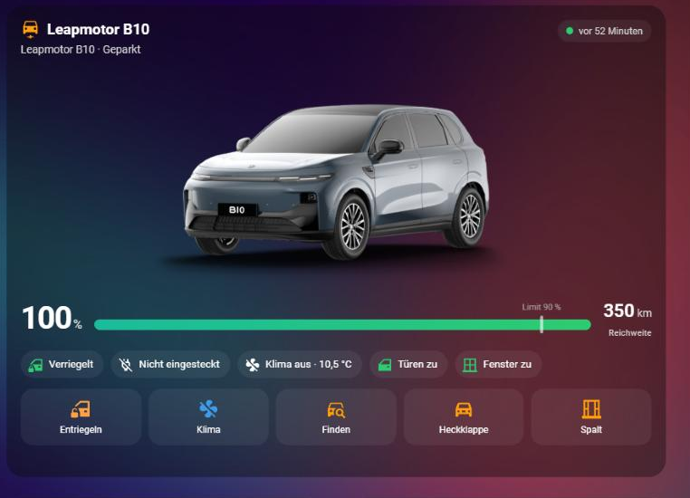
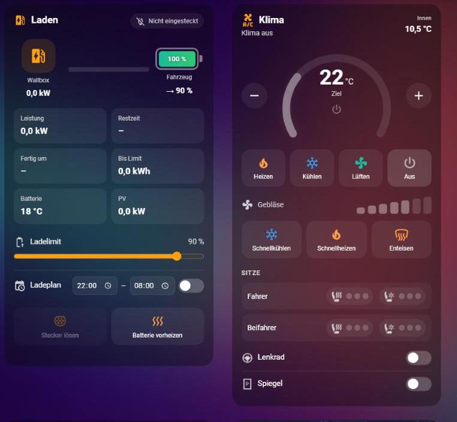
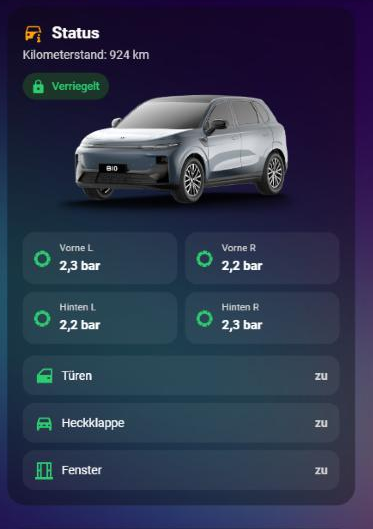
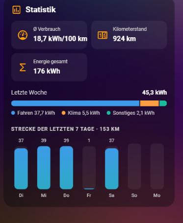

# Leapmotor Cloud für Home Assistant

Leapmotor-Fahrzeuge (C10, B10, T03, C11, C16, …) in Home Assistant überwachen und steuern –
mit dem Funktionsumfang der offiziellen App, einem animierten Dashboard und allen Daten, die
man zum Optimieren des Ladens braucht.

🇬🇧 [English version](README.md)

> **Inoffiziell.** Dieses Projekt steht in keiner Verbindung zu Leapmotor. Leapmotor bietet
> keine öffentliche Schnittstelle; die Integration nutzt dieselbe Cloud wie die App und kann
> aufhören zu funktionieren, wenn Leapmotor sie ändert. Nutzung auf eigene Gefahr.

*Screenshots mit einem echten Leapmotor B10. Das Auto wird mit den Bildern aus der App
angezeigt, in seiner echten Farbe.*



Offene Türen, Heckklappe und das Ladekabel werden wie in der App angezeigt:




| Status | Statistik |
|---|---|
|  |  |

## Funktionen

**Daten** – Ladezustand, Reichweite, Ladestatus und -leistung, Restladezeit, Ladeende, Energie
bis zum Ladelimit, Batterietemperatur, Verriegelung, Türen, Fenster, Heckklappe, Reifendruck,
Innen-/Außentemperatur, Klima, Sitzheizung/-belüftung, Lenkrad- und Spiegelheizung,
GPS-Position, Kilometerstand, Energieverbrauch (heute, letzte Woche, gesamt), Strecke der
letzten sieben Tage, Durchschnittsverbrauch, letzte Ladevorgänge, Nachrichten und
Softwareversion.

**Steuerung** – Ver-/Entriegeln, Laden starten/stoppen, Ladelimit, Ladeplan (an/aus, Beginn,
Ende), Ladestecker entriegeln, Klimaanlage (Modus, Temperatur, Gebläse, Schnellkühlen,
Schnellheizen, Enteisen), Sitzheizung und -belüftung, Lenkrad- und Spiegelheizung, Batterie
vorheizen, akkuschonendes Laden, Wächtermodus, Fenster, Sonnenschutz, Heckklappe, Fahrzeug
finden, Ziel an die Navigation senden, Klima-Timer und „Fahrzeug vorbereiten“.

**Die PIN wird automatisch verwendet** – du gibst die Fahrzeug-PIN einmal bei der Einrichtung
ein. Verlangt ein Befehl die PIN, setzt Home Assistant sie selbst ein. Lehnt die Cloud die PIN
ab, wird sie nie wieder gesendet – so kann die Fernsteuerung nicht durch Fehlversuche gesperrt
werden.

**Schont das Konto** – adaptive Abfragen (5 min beim Laden, Fahren oder Klimatisieren, 30 min
geparkt), eine dauerhafte Cloud-Sitzung statt neuer Anmeldungen, Begrenzung von Anmeldungen
und Anfragen pro Tag und Pausen bei Fehlern. Optional löst ein Leistungssensor der Wallbox
genau dann ein Update aus, wenn das Laden beginnt oder endet.

**Dashboard** – fünf animierte Karten (Fahrzeug, Laden, Klima, Status, Statistik) und eine
Dashboard-Strategie, die das ganze Dashboard automatisch aufbaut.

**Echte Fahrzeugbilder** – Fahrzeug- und Statuskarte zeigen die Bilder, die die offizielle App
für *dein* Auto zeigt: dein Modell in deiner Farbe, mit offenen Türen, Heckklappe, Fenstern und
der Lade-Animation, zusammengesetzt aus den Bild-Ebenen der App. Sie werden einmal aus der
Leapmotor-Cloud geladen, in Home Assistant gespeichert und nur an angemeldete Nutzer
ausgeliefert; im Repository sind sie nicht enthalten. Mit der Kartenoption `image` lässt sich
stattdessen ein eigenes Bild verwenden (z. B. `/local/mein-auto.png` aus `config/www`). Nur wenn
es gar keine Bilder gibt (das simulierte Fahrzeug hat keine), zeichnen die Karten ein Auto.

**Ohne Auto ausprobieren** – ein simuliertes Fahrzeug zeigt alle Entitäten, Karten und Befehle.

### Warum Cloud und nicht lokal?

Leapmotor-Fahrzeuge haben keine lokale Schnittstelle (keine LAN/WLAN-API, kein offenes
Bluetooth-Protokoll). Auch die App spricht nur mit der Cloud des Herstellers.

## Voraussetzungen

- Home Assistant 2025.10 oder neuer
- Ein Leapmotor-Konto, dem das Fahrzeug gehört oder mit dem es geteilt ist. **Empfehlung:**
  ein zweites Konto anlegen und das Fahrzeug in der App damit teilen. Dasselbe Konto in Home
  Assistant und auf dem Handy kann das Handy abmelden.
- Das **App-Zertifikat** (`app_cert.pem` und `app_key.pem`). Die Leapmotor-Cloud akzeptiert
  nur Verbindungen mit dem Client-Zertifikat der offiziellen App. Es ist **nicht** Teil dieses
  Repositorys, für alle Nutzer gleich und wird von den unter [Credits](#credits) genannten
  Community-Projekten bereitgestellt. Prüfe die rechtliche Lage in deinem Land.
- Die Fahrzeug-PIN (nur für Befehle; Daten funktionieren ohne)

## Installation

### HACS (empfohlen)

1. HACS → ⋮ → *Benutzerdefinierte Repositorys* → `https://github.com/VierNeunStein/ha-leapmotor-cloud`
   als Typ *Integration* hinzufügen.
2. **Leapmotor Cloud** installieren und Home Assistant neu starten.

### Manuell

`custom_components/leapmotor_cloud` nach `config/custom_components/` kopieren und Home Assistant
neu starten.

## Einrichtung

1. *Einstellungen → Geräte & Dienste → Integration hinzufügen → Leapmotor Cloud*.
2. **Leapmotor-Konto verbinden** wählen (oder **Simuliertes Fahrzeug ausprobieren**).
3. App-Zertifikat und Schlüssel hochladen oder einfügen. Liegen `app_cert.pem` und
   `app_key.pem` schon in `config/leapmotor_cloud/` (oder `config/leapmotor/`), entfällt der
   Schritt.
4. Mit E-Mail-Adresse und Passwort anmelden.
5. PIN jedes Fahrzeugs eingeben (optional). Sie wird einmal bei der Cloud geprüft.

Optionen (*Konfigurieren*): Abfrage-Intervalle, Leistungssensor der Wallbox, Tageslimit für
Anfragen, Fahrzeug-PINs und Prüfung des Server-Zertifikats.

## Dashboard

Neues Dashboard anlegen (*Einstellungen → Dashboards → Dashboard hinzufügen → Neues Dashboard
von Grund auf*), öffnen, ⋮ → *Dashboard bearbeiten* → ⋮ → *Raw-Konfigurationseditor* und alles
ersetzen durch:

```yaml
strategy:
  type: custom:leapmotor-dashboard
  # optional:
  wallbox_entity: sensor.wallbox_leistung
  solar_entity: sensor.pv_leistung
```

Die Strategie erzeugt pro Fahrzeug eine Ansicht (Fahrzeug, Laden, Klima, Status, Karte,
Statistik, Verlauf) und eine Ansicht mit allen Entitäten. Sobald ein echtes Fahrzeug existiert,
wird das simulierte ausgeblendet. Die Karten lassen sich auch einzeln verwenden (siehe
[englische Anleitung](README.md#dashboard)); schwer rückgängig zu machende Befehle (Entriegeln,
Heckklappe/Fenster öffnen, Stecker lösen) brauchen einen zweiten Tipp zur Bestätigung.

## Laden optimieren

- **Energie bis zum Ladelimit** und **Ladeende** sagen Automationen, wie viel Energie noch
  fehlt und wann das Laden fertig ist.
- **Ladelimit**, **Ladeplan Beginn/Ende** und der Schalter **Laden** lassen sich per
  Automation setzen (z. B. vor langen Fahrten 100 %, sonst 80 %).
- Der Blueprint [`solar_charging.yaml`](blueprints/automation/leapmotor_cloud/solar_charging.yaml)
  startet das Laden bei genug PV-Überschuss und stoppt es, wenn zu viel aus dem Netz kommt –
  mit Mindestabständen zwischen den Befehlen.

## Abfragen und Kontoschutz

| | Standard | Minimum |
|---|---|---|
| Intervall bei Aktivität (Laden, Fahren, Klima, gerade benutzt) | 5 min | 2 min |
| Intervall in Ruhe | 30 min | 10 min |
| Verlauf und Statistik | 60 min | 30 min |
| Anfragen pro Tag (danach stündlich) | 1500 | 200 |

Die Cloud-Sitzung wird gespeichert und per Refresh-Token erneuert; höchstens vier Anmeldungen
in sechs Stunden und nie zwei innerhalb von zwei Minuten. Endet die Sitzung immer wieder
(Konto parallel auf dem Handy), pausiert die Integration zwei Stunden und erklärt die Lösung in
einem Reparaturhinweis. Falsches Passwort → Neuanmeldung statt Wiederholungen. Nach einem Befehl
wird nach 8 s, 30 s und 90 s nachgesehen.

## Sicherheit und Datenschutz

Das Server-Zertifikat wird bei der Einrichtung **gepinnt**. Eine reguläre Erneuerung kurz vor
Ablauf wird automatisch übernommen, jede andere Änderung muss bestätigt werden, bevor etwas
gesendet wird. Passwort, PIN und Zertifikate liegen im Config-Entry von Home Assistant, die
Cloud-Sitzung in einer privaten Speicherdatei. Diagnose-Downloads entfernen FIN, Position,
Kontodaten, PINs und Zertifikate.

## Credits

Das Protokollwissen stammt aus der Community: [kerniger/leapmotor-ha](https://github.com/kerniger/leapmotor-ha)
und [markoceri/leapmotor-api](https://github.com/markoceri/leapmotor-api) (Dank an Jakob Kern
für das Reverse Engineering). Diese Integration ist eine eigenständige Implementierung.

## Lizenz

[MIT](LICENSE)
