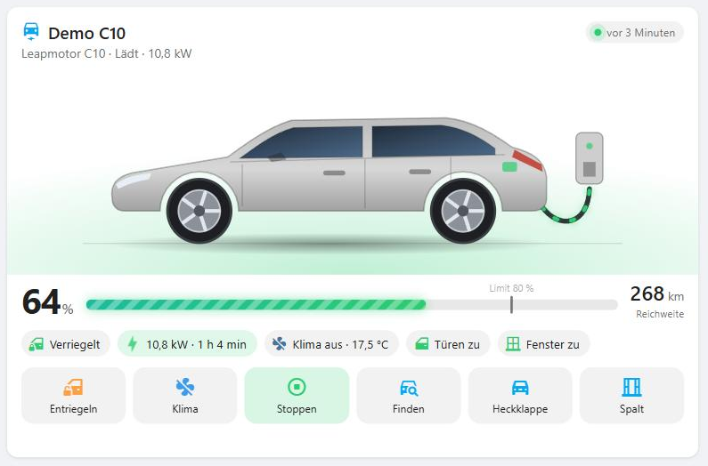
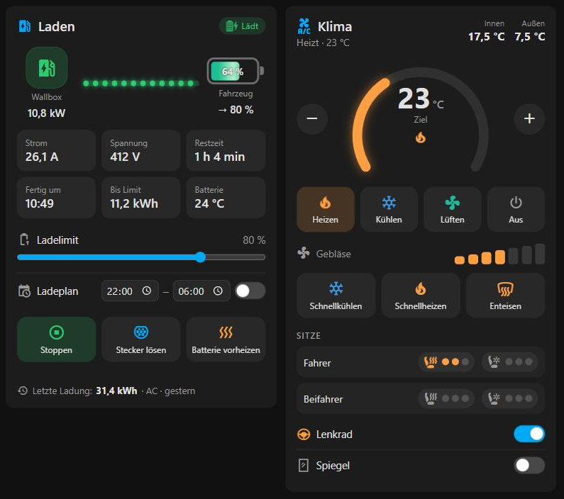
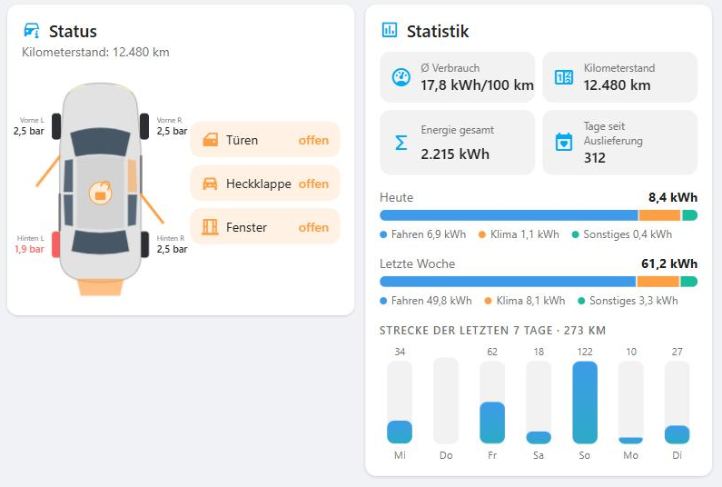

# Leapmotor Cloud for Home Assistant

[](https://hacs.xyz/)
[](https://www.home-assistant.io/)
[](https://github.com/VierNeunStein/ha-leapmotor-cloud/actions/workflows/validate.yml)

Monitor and control Leapmotor vehicles (C10, B10, T03, C11, C16, …) from Home Assistant, with
the same functions as the official app, an animated dashboard and everything you need to
optimise charging.

🇩🇪 [Deutsche Anleitung](README.de.md)

> **Unofficial.** This project is not affiliated with, endorsed or supported by Leapmotor.
> Leapmotor offers no public API; the integration talks to the same cloud as the app and may
> stop working when Leapmotor changes it. Use it at your own risk.



| | |
|---|---|
|  |  |

## Features

**Data** – state of charge, range, charging state and power, time to full, finish time,
energy to the charge limit, battery temperature, lock, doors, windows, tailgate, tire
pressures, interior/outdoor temperature, climate, seat heating/ventilation, steering wheel and
mirror heating, GPS position, odometer, energy use (today, last week, total), distance of the
last seven days, average consumption, last charging sessions, messages and software version.

**Control** – lock/unlock, start/stop charging, charge limit, charging schedule (on/off,
start, end), release the charging connector, air conditioning (mode, temperature, fan,
quick cool, quick heat, defrost), seat heating and ventilation, steering wheel and mirror
heating, battery preheating, battery care charging, sentry mode, windows, sunshade, tailgate,
find vehicle, send a destination to the navigation, climate timers and one-touch vehicle
preparation.

**The PIN is handled for you** – you enter the vehicle PIN once during setup. Whenever a
command needs it, Home Assistant uses it automatically. A PIN that the cloud rejects is never
sent again, so remote control cannot get locked by repeated wrong attempts.

**Gentle on your account** – the integration polls adaptively (5 min while charging, driving
or air-conditioning, 30 min when parked), keeps one cloud session alive instead of logging in
again, limits logins and requests per day and backs off on errors. Optionally a wallbox power
sensor triggers an update exactly when charging starts or stops.

**Dashboard** – five animated cards (vehicle, charging, climate, status, statistics) and a
dashboard strategy that builds the whole dashboard automatically.

**Real vehicle pictures** – the vehicle and status cards show the pictures the official app shows
for *your* car: your model in your colour, with open doors, tailgate, windows and the charging
animation stacked from the app's picture layers. They are downloaded once from the Leapmotor
cloud, kept in Home Assistant and served only to signed-in users; they are not part of this
repository.

**Try it without a car** – a simulated vehicle shows every entity, card and command.

### Why the cloud?

Leapmotor vehicles have no local interface (no LAN/Wi-Fi API, no open Bluetooth protocol).
The app itself only talks to the manufacturer's cloud, so this integration does the same.

## Requirements

- Home Assistant 2025.10 or newer
- A Leapmotor account the vehicle belongs to or is shared with. **Recommended:** create a
  second account and share the vehicle with it in the app. Using the same account in Home
  Assistant and on the phone can log the phone out.
- The **app certificate** (`app_cert.pem` and `app_key.pem`). The Leapmotor cloud only
  accepts connections that present the client certificate of the official app. It is **not**
  included in this repository. It is the same for every user and is published by the
  community projects linked under [Credits](#credits). Check the legal situation in your
  country before using it.
- The vehicle PIN (only for commands; data works without it)

## Installation

### HACS (recommended)

1. HACS → ⋮ → *Custom repositories* → add `https://github.com/VierNeunStein/ha-leapmotor-cloud`
   as type *Integration*.
2. Install **Leapmotor Cloud** and restart Home Assistant.

### Manual

Copy `custom_components/leapmotor_cloud` into `config/custom_components/` and restart Home
Assistant.

## Setup

1. *Settings → Devices & services → Add integration → Leapmotor Cloud*.
2. Choose **Connect a Leapmotor account** (or **Try a simulated vehicle**).
3. Upload or paste the app certificate and key. If you put `app_cert.pem` and `app_key.pem`
   into `config/leapmotor_cloud/` (or `config/leapmotor/`) beforehand, this step is skipped.
4. Sign in with email and password.
5. Enter the PIN of each vehicle (optional). It is checked once with the cloud.

Options (*Configure*): polling intervals, wallbox power sensor, daily request limit, vehicle
PINs and server certificate checking.

## Dashboard

Create a new dashboard (*Settings → Dashboards → Add dashboard → New dashboard from scratch*),
open it, choose ⋮ → *Edit dashboard* → ⋮ → *Raw configuration editor* and replace everything
with:

```yaml
strategy:
  type: custom:leapmotor-dashboard
  # optional:
  wallbox_entity: sensor.wallbox_power
  solar_entity: sensor.pv_power
```

The strategy creates a view per vehicle (vehicle, charging, climate, status, map, statistics,
history) and a view with all entities. When a real vehicle exists, the simulated one is hidden.

The cards can also be used on their own (all have a visual editor):

| Card | Options |
|---|---|
| `custom:leapmotor-vehicle-card` | `device_id`, `show_picture`, `image` |
| `custom:leapmotor-charging-card` | `device_id`, `wallbox_entity`, `solar_entity` |
| `custom:leapmotor-climate-card` | `device_id` |
| `custom:leapmotor-status-card` | `device_id`, `show_picture`, `image` |
| `custom:leapmotor-stats-card` | `device_id` |

Without `device_id` the first vehicle is used. `image` replaces the app pictures with an own
picture (URL, e.g. `/local/my-car.png` for a file in `config/www`); `show_picture: false` turns
the pictures off. When there are no pictures at all (the simulated vehicle has none), the cards
draw a stylised car instead. Cards find their entities by device, so renamed
entity ids keep working. Commands that are hard to undo (unlock, open tailgate, open windows,
release connector) need a second tap to confirm.

## Optimising charging

- **Energy to charge limit** and **charging finished at** tell automations how much energy is
  still needed and when.
- **Charge limit**, **charging schedule start/end** and the **charging** switch can be set by
  automations (e.g. charge to 100 % before a long trip, otherwise 80 %).
- The blueprint [`solar_charging.yaml`](blueprints/automation/leapmotor_cloud/solar_charging.yaml)
  starts charging when there is enough PV surplus and stops it when the house draws too much
  from the grid, with minimum times between commands.

  [](https://my.home-assistant.io/redirect/blueprint_import/?blueprint_url=https%3A%2F%2Fgithub.com%2FVierNeunStein%2Fha-leapmotor-cloud%2Fblob%2Fmain%2Fblueprints%2Fautomation%2Fleapmotor_cloud%2Fsolar_charging.yaml)

Example: charge to 100 % on Fridays only.

```yaml
automation:
  - alias: "Leapmotor: 100 % on Friday nights"
    triggers:
      - trigger: time
        at: "21:00:00"
    actions:
      - action: number.set_value
        target:
          entity_id: number.leapmotor_c10_charge_limit
        data:
          value: "{{ 100 if now().weekday() == 4 else 80 }}"
```

## Actions (services)

| Action | Purpose | PIN |
|---|---|---|
| `leapmotor_cloud.refresh` | Ask the cloud for new data now | – |
| `leapmotor_cloud.set_climate` | Air conditioning with mode, temperature, fan, recirculation, defrost | ✓ |
| `leapmotor_cloud.set_charge_schedule` | Charging schedule and/or charge limit (unset values stay) | ✓ |
| `leapmotor_cloud.set_climate_schedule` | Climate timer (replaces existing ones) | ✓ |
| `leapmotor_cloud.cancel_climate_schedule` | Remove all climate timers | ✓ |
| `leapmotor_cloud.prepare_car` | Climate, seats, steering wheel and mirrors in one go | ✓ |
| `leapmotor_cloud.send_destination` | Send a destination to the navigation | – |
| `leapmotor_cloud.send_command` | Raw command by id, for experiments | optional |

`device_id` is only needed when there are several vehicles.

## Polling and account safety

| | Default | Minimum |
|---|---|---|
| Interval while active (charging, driving, climate, just used) | 5 min | 2 min |
| Interval while idle | 30 min | 10 min |
| History and statistics | 60 min | 30 min |
| Requests per day (then once an hour) | 1500 | 200 |

- The cloud session (token and account certificate) is stored and renewed with the refresh
  token, so a restart does not log in again.
- At most four logins per six hours and never two within two minutes. If the session keeps
  ending (account used on a phone at the same time), polling pauses for two hours and a repair
  issue explains what to do.
- Wrong email/password → re-authentication instead of retries. Rate limiting → two hours
  pause. Errors → exponential back-off; the last values stay for up to two hours.
- After a command the vehicle is checked 8 s, 30 s and 90 s later.

## Security and privacy

- The server certificate is **pinned** at setup (the Leapmotor gateway uses a private CA). A
  regular renewal shortly before expiry is accepted automatically; any other change has to be
  confirmed in a repair dialog before anything is sent. Mode *strict* confirms every change,
  mode *off* disables the check (not recommended).
- Password, PIN and certificates are stored in Home Assistant's config entry, the cloud session
  in a private storage file. Nothing is sent anywhere except to the Leapmotor cloud.
- Diagnostics downloads remove VIN, position, account data, PINs and certificates.

## Troubleshooting

- **Login fails (`invalid_auth`)** although the app works: sign out of the app completely and
  change the password once in the app.
- **Certificate rejected**: Leapmotor may have replaced the app certificate with an app update.
  Provide the current one under *⋮ → Reconfigure*.
- **Commands are not confirmed**: the vehicle may be in deep sleep or without reception.
- **Debug logging**:

  ```yaml
  logger:
    logs:
      custom_components.leapmotor_cloud: debug
  ```

## Development

```bash
pip install pytest pytest-asyncio aiohttp cryptography
pytest tests --ignore=tests/ha            # client, parser, commands (any Python ≥ 3.12)
pip install pytest-homeassistant-custom-component
pytest tests/ha                           # integration inside Home Assistant (Python 3.14, Linux/macOS)
```

The client tests run against a local stand-in of the cloud (TLS with client certificates,
signatures, token expiry, PIN check, commands). `custom_components/leapmotor_cloud/api` does not
depend on Home Assistant and can be used on its own.

## Credits

The protocol knowledge comes from the community: [kerniger/leapmotor-ha](https://github.com/kerniger/leapmotor-ha)
and [markoceri/leapmotor-api](https://github.com/markoceri/leapmotor-api) (with thanks to Jakob
Kern for the reverse engineering). This integration is an independent implementation.

## License

[MIT](LICENSE)
